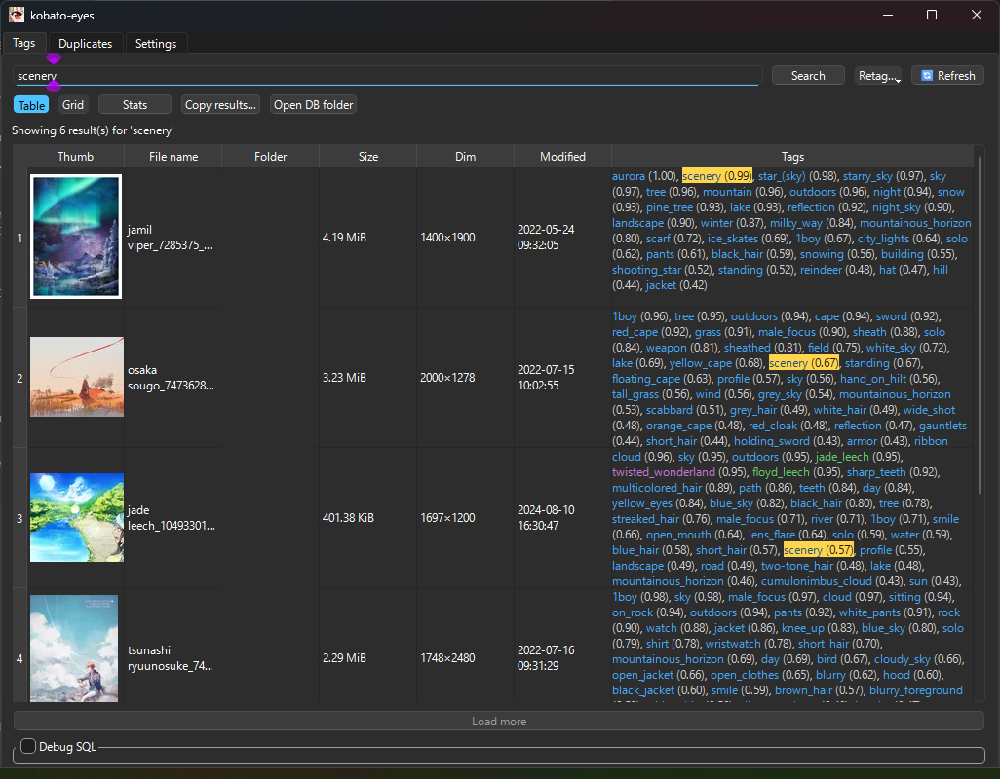

# kobato-eyes



**kobato-eyes** は、ローカル PC 上の画像に Danbooru タグを自動付与し、類似画像検出と検索を行う Windows 向けデスクトップアプリケーションです。PyQt6 を用いた GUI と SQLite + FTS5 データベースを組み合わせ、スキャンからタグ付け、検索、重複チェックまでを一貫して実行します。

## Quick Setup（PixAI Tagger v1.0）

1. [リリースページ](https://github.com/srndpty/kobato-eyes/releases)から **PixAI v1.0対応版** の7zまたはzipをダウンロードし、展開して `kobato-eyes.exe` を起動します。
   ソースから実行する場合は下の[開発環境クイックスタート](#クイックスタート開発環境)を使ってください。
2. 検証済みの [noaione/pixai-tagger-v1.0-onnx](https://huggingface.co/noaione/pixai-tagger-v1.0-onnx/tree/68e8f4f02dd56a5f40c1b7474489fa0f599dec34) から、次の **3ファイル** をダウンロードし、同じフォルダに置きます。自分でONNXへ変換する必要はありません。

   ```text
   %APPDATA%\kobato-eyes\models\pixai1.0\
   ├─ model.onnx
   ├─ model.onnx.data
   └─ tags.json
   ```

   これは推奨の保存先です。別の場所でも利用できます。`model.onnx.data`は約1.95GBあり、`model.onnx`と一緒に保持してください。
3. Settingsタブで以下を設定します。

   | 項目 | 設定 |
   | --- | --- |
   | Roots | タグ付け対象の画像フォルダ（1行に1フォルダ） |
   | Tagger | **`pixai-v1-onnx`** |
   | Model path | Browseから保存先の`model.onnx`を選択 |
   | Labels JSON | 空欄（隣の`tags.json`を自動検出） |
   | Device | NVIDIA CUDA環境では`CUDA only`。CPUで使う場合は`CPU only` |
   | Batch size / Prefetch depth | まずはどちらも`1` |

   **Apply**を押し、モデル診断が`Model status: OK`、`Detected tagger backend: pixai-v1`になることを確認します。
   v1.0では`selected_tags.csv`は使いません。`wd14-onnx`を選ぶとCSVを探してエラーになるため、Taggerの選択に注意してください。
4. Tagsタブで **Index Now** を押すとタグ付けが始まります。

Taggerの選択肢に`pixai-v1-onnx`がない場合は、v1.0対応のアプリへ更新するか、最新ソースから`dev run`で起動してください。
閾値調整・設定例・検証方法は [PixAI v1.0ガイド](docs/pixai-v1.md) にまとめています。

## Instant Usage

- PixAI v1.0は30,877タグに対応し、general・character・copyright・style・meta・ratingを保存・検索できます。styleで絞る場合は`category:style`を使います。
- タグ付けはNVIDIA GPU推奨です。6カテゴリの閾値はSettingsで調整できます。
- 採用したnoaione版ONNXはバッチ1固定です。アプリ側のBatch sizeを増やしても、モデルは内部で1枚ずつ処理します。
- RTX4090での数値比較・速度・メモリ測定は [検証結果](docs/pixai-v1-validation.md) を参照してください。実画像の大きさや環境で処理時間は変わります。
- モデルを切り替えただけでは全画像の再タグ付けは始まりません。次回のインデックス処理で構成の変化を判定し、必要な画像を再タグ付けします。

- 検索はSQL-like（空白区切りでAND検索、空白で区切った | か OR でOR検索、-かNOTで除外検索が使用可能）
- statsボタンで付けたタグの統計情報表示
- Copy resultsで検索にヒットした画像を新規別フォルダにコピー
- フォルダの中身が変わったら🔄refreshボタンで新規・削除画像を検出してデータ更新
- duplicatesタブは同じsettingsタブのrootsが対象
- hamming, max_bitsは数字を小さくするとわずかな違いで別画像と判定するようになり、大きくすると差異が多くても重複と判定するようになる (smaller is stricter)
- gridは逆に、数字を大きくすると厳格に、小さくするとゆるく重複判定 (bigger is stricter)

## 既知の制限

- モデルの推論結果には誤検出・見落としがあるため、用途に合わせて閾値を調整してください。
- DBはタグ名ごとにカテゴリを1つ持ちます。同名のartist/styleタグを異なるモデルで登録すると、そのタグのカテゴリ検索にも影響します。詳細は [PixAI v1.0ガイド](docs/pixai-v1.md#設定とカテゴリ) を参照してください。

## 開発に参加する

このプロジェクトに貢献したい方は、以下を参照してください：

- **[CLAUDE.md](CLAUDE.md)** — 開発者向けの統一的なガイド（環境構築、コード規約、モジュール構成、テスト方針）
- **[AGENTS.md](AGENTS.md)** — 実装エージェント向けの詳細な指針
- **[docs/architecture.md](docs/architecture.md)** — システムアーキテクチャとデータフロー図

### クイックスタート（開発環境）

Python 3.10.xとNVIDIA CUDA環境でPixAI v1.0を使う場合：

```powershell
python -m venv .venv
.\.venv\Scripts\python.exe -m pip install --upgrade pip
.\.venv\Scripts\python.exe -m pip install -c requirements-dev.lock -e ".[dev,tagging-gpu]"
.\dev.ps1 run                       # 起動後、上のQuick Setupに従ってモデルを設定
```

CPUで使う場合は`tagging-gpu`を`tagging-cpu`へ置き換えてください。
仮想環境のactivateと`PYTHONPATH`の手動設定は不要です。`dev`が実行環境を設定します。

```powershell
.\dev.ps1 test -q                   # 高速な単体テスト
.\dev.ps1 check                     # コード品質・型・coverage付きテスト
```

## 開発用コマンド

リポジトリ直下の `dev.ps1` を開発操作の入口として使えます。仮想環境のactivateは不要で、
`.venv\Scripts\python.exe` を優先します。未作成の場合はPATH上の`python`を使います。
依存関係の導入は上記セットアップ手順で行ってください。

```powershell
.\dev.ps1 help
.\dev.ps1 run                       # アプリ起動（guiも同じ動作）
.\dev.ps1 test -q                   # 高速なheadlessテスト
.\dev.ps1 test gui -k settings      # 実QtによるGUI/smokeテスト
.\dev.ps1 test integration          # integration（GPUを除外）
.\dev.ps1 test package              # package tree / compileall
.\dev.ps1 lint                      # Ruff lint + format検証
.\dev.ps1 check                     # 既存check.ps1（coverage用GUI確認も含む）
.\dev.ps1 check -NoIncremental      # キャッシュなし型解析
```

`test gpu`、`test db-stress`も既存テストに対応しています。pytestのパス・`-k`・`-q`などは
そのまま転送します。相対パスはリポジトリ直下を基準に解釈します。`lint --fix`はRuff lintの自動修正を行い、formatは引き続き検証します。
`build`は既存のPyInstaller specから`dist/kobato-eyes`を作成します。
初回は `.\.venv\Scripts\python.exe -m pip install -c requirements-dev.lock -e ".[dev,tagging-gpu,packaging]"`
で必要な依存を入れてください。バージョン付き配布アーカイブの作成には従来の`package-release.ps1`を使います。
削除範囲が未定義の`clean`は今回は実装していません。

`C:\Users\lambe\bin\dev.ps1` のグローバルディスパッチャーがPATH上にある環境では、
リポジトリ直下からそのまま `dev run`、`dev test`、`dev check` と呼べます。
現在のグローバルディスパッチャーは親ディレクトリを探索しないため、`dev`はリポジトリ直下で使ってください。
ローカルスクリプト自体は別ディレクトリから絶対パスでも呼べ、実行後は呼び出し元の場所と環境変数を戻します。
`dev.cmd`はcmd.exe向けの薄いwrapperで、PowerShell 7を優先し、なければWindows PowerShellを使います。
いずれもコマンドの終了コードを呼び出し元へ返します。グローバル側の変更は不要です。

## 主な機能

- **タグ付けパイプライン**: 監視対象ディレクトリをスキャンし、ONNX Runtime (WD14 / PixAI) で画像に Danbooru タグを推論。閾値や最大タグ数はプロバイダーごとに調整可能です。
- **重複検出**: pHash による候補抽出と SSIM / ORB による最終判定で近似重複を抽出し、UI 上でクラスタごとに整理・破棄操作が可能です。
- **検索 UI**: タグ検索・オートコンプリート・統計表示・重複レビューなどを備えたタブ UI。設定タブから監視ルートやモデルパス、閾値を編集できます。
- **堅牢なデータ管理**: SQLite (WAL / 外部キー ON) に画像メタ情報とタグを格納し、FTS5 で高速全文検索を提供。AppData 配下にデータ・ログ・インデックスを自動作成します。
- **拡張性**: core/、ui/、tagger/、dup/、sig/ などモジュール分割済みで、カスタムタグガーやステージを追加しやすい構成です。

## プロジェクト構成

```
src/
├─ core/        # パイプライン、設定、ジョブ管理
├─ db/          # SQLite スキーマとリポジトリ
├─ dup/         # 重複検出ロジック
├─ index/       # ベクトル検索モジュール（将来的な拡張用）
├─ sig/         # 画像署名と特徴量計算
├─ tagger/      # ONNX タガー実装 (WD14 / PixAI / ダミー)
├─ ui/          # PyQt6 GUI、ViewModel、ウィジェット
└─ utils/       # 共通ユーティリティ
```

`tests/` にはパイプライン・DB・UI helper・ユーティリティ向けの自動テストが配置されています。

## 前提条件

- Windows 10 以降を想定 (開発環境は他 OS でも可)
- ソースから実行する場合はPython 3.10.x（配布exeではPythonの別途導入は不要）
- CUDA 対応 GPU (onnxruntime-gpu 使用時。CPU 版に差し替える場合は `onnxruntime` を利用)
- Visual C++ 再頒布可能パッケージ / GPU ドライバ等の依存関係

## セットアップ（ソースから開発する場合）

```powershell
git clone https://github.com/srndpty/kobato-eyes.git
cd kobato-eyes
python --version  # Python 3.10.xであることを確認
python -m venv .venv
.\.venv\Scripts\python.exe -m pip install --upgrade pip
.\.venv\Scripts\python.exe -m pip install -c requirements-dev.lock -e ".[dev,tagging-gpu]"

# Git hookを使う場合
.\.venv\Scripts\python.exe -m pip install pre-commit
.\.venv\Scripts\python.exe -m pre_commit install
```

CPU環境では`tagging-gpu`を`tagging-cpu`へ置き換えます。CLIP / hnswlibのベクトル検索は後続機能で、
現状の`src/index/`は未使用stubです。依存関係の事前検証を行う場合のみ`vector` extraを追加します。

### モデルファイルの配置

通常は上の[Quick Setup](#quick-setuppixai-tagger-v10)に従い、PixAI v1.0の3ファイルを配置します。
モデルは配布バイナリに同梱していません。`tmp/`などの一時領域ではなく、継続利用するフォルダへ保存してください。

他の対応モデルを使う場合：

| モデル | GUIのTagger | 同じフォルダへ置くファイル |
| --- | --- | --- |
| PixAI v1.0（noaione版） | `pixai-v1-onnx` | `model.onnx`・`model.onnx.data`・`tags.json` |
| [PixAI v0.9](https://huggingface.co/deepghs/pixai-tagger-v0.9-onnx/tree/main) | `wd14-onnx` | `model.onnx`・`selected_tags.csv`・`preprocess.json` |
| [WD14](https://huggingface.co/SmilingWolf/wd-swinv2-tagger-v3/tree/main) | `wd14-onnx` | `model.onnx`・`selected_tags.csv` |

旧PixAI / WD14の自動判定は`wd14-onnx`経路のものです。PixAI v1.0は専用の`pixai-v1-onnx`を選んでください。

## 実行方法

リポジトリ直下で起動します。`gui`も同じ起動処理です。

```powershell
.\dev.ps1 run
# グローバルディスパッチャーがPATH上にある場合
# dev run
```

初回起動時にはスプラッシュ画面でデータベースを初期化します。
設定は`%APPDATA%\kobato-eyes\config.yaml`、DB・インデックス・ログは同ディレクトリ配下に作成されます。

### ヘッドレス環境

CIなどでGUIを起動しない場合は、環境変数`KOE_HEADLESS=1`を指定するとQtの初期化を回避します。
`dev test`は自動でヘッドレス設定を行い、`dev run`は起動時にこの設定を解除します。

## 設定とカスタマイズ

- **config.yaml**: 監視ルート (`roots`)、除外パス (`excluded`)、拡張子フィルター (`allow_exts`)、バッチサイズ、重複閾値 (`hamming_threshold` / `ssim_threshold`)、タガー設定などを定義。
- **環境変数**:
  - `KOE_DATA_DIR` — デフォルトの AppData 以外にデータディレクトリを変更
  - `KOE_LOG_LEVEL` — `DEBUG`/`INFO` などログレベル指定
  - `KOE_HEADLESS` — ヘッドレスモード切り替え

## データベースとインデックス

- SQLite3 + WAL モードで DB を保存し、`fts_files` テーブルで FTS5 を利用します。
- `src/index/` は後続の CLIP / hnswlib ベクトル近傍探索用の未使用 stub です。現行リリースの検索と重複検出は SQLite / FTS5 / pHash / SSIM / ORB 経路で動作します。
- ログは `%APPDATA%\kobato-eyes\logs\app.log` にローテーション出力されます。

## テスト / CI

CI は GitHub Actions 上の Windows + Python 3.10 で実行し、ローカル開発と同じ `requirements-dev.lock` を pip constraints として参照します。高速な単体確認は `.\dev.ps1 test` を使います。標準の `.\scripts\check.ps1`（`dev check`）は非GUIテストとcoverage用GUI/smoke確認を実行し、integration / db_stress / gpuは別途実行します。

```powershell
.\scripts\check.ps1
```

変更内容に応じて、以下の追加チェックを使います。

```powershell
.\scripts\check-gui-smoke.ps1        # PyQt6 / worker / GUI 状態変更
.\scripts\check-integration.ps1      # pipeline / DB bootstrap / end-to-end
.\scripts\check-db-stress.ps1        # SQLite lock / WAL / checkpoint / quiesce
.\scripts\check-package-smoke.ps1    # import 構造 / tools / packaging
.\scripts\check-gpu.ps1              # ONNX Runtime CUDA / GPU smoke
```

pre-commit と CI の整形差分を避けるため、Ruff は `pyproject.toml` と `.pre-commit-config.yaml` のバージョン・ターゲットを揃えています。

pre-commitのmypyは、`src/`のPythonコード、型チェック設定、依存関係の変更時に全設定対象を検査します。
ドキュメント・テストだけの変更ではmypyを起動せず、Ruffなどの該当チェックは通常どおり実行します。
hook環境と開発環境のキャッシュは `tmp/mypy_cache/pre-commit` と `tmp/mypy_cache/check` に分離しています。
`check.ps1` のmypyは標準で増分解析を使い、依存するコードの変更も追跡します。
CIと同様にキャッシュを使わず型解析し直す場合は次を使ってください（テストの実行範囲は同じです）。

```powershell
.\scripts\check.ps1 -NoIncremental
.\.venv\Scripts\python.exe -m pre_commit run --files README.md  # 文書のみ: mypyはskip
```

## パッケージング

1. Python 3.10.x の環境でリリース作成用依存をインストール: `python -m pip install -c requirements-dev.lock -e ".[dev,tagging-gpu,packaging]"`
2. main ブランチを最新化: `git switch main` → `git pull`
3. リリース前チェックを実行: `.\scripts\check.ps1` と `.\scripts\check-package-smoke.ps1`
4. リリース用バイナリと 7z を生成: `.\scripts\package-release.ps1 -Version v0.7 -Clean`
5. `dist\release\kobato-eyes-v0.7-win-x64.7z` と `dist\release\SHA256SUMS.txt` が出力されます
6. Windows 標準展開用の zip も作る場合: `.\scripts\package-release.ps1 -Version v0.7 -Clean -Zip`
7. main のリリースコミットを push: `git push origin main`
8. リリースタグを作成して push: `git tag -a v0.7 -m "v0.7"` → `git push origin v0.7`
9. モデルファイルは同梱せず、利用者が Quick Setup の手順で配置します

`package-release.ps1` は PyInstaller と 7-Zip (`7z` または `7zz`) を使用します。PyInstaller は `packaging` extra で導入されます。7-Zip は事前にインストールし、PATH または標準インストール先から見つかる状態にしてください。

## トラブルシューティング

- **PixAI v1.0で`selected_tags.csv was not found`と表示される**：SettingsのTaggerを`wd14-onnx`から`pixai-v1-onnx`に変更し、モデルパスを再確認してApplyを押してください。
- **`model.onnx`を移動したら読み込めない**：`model.onnx.data`と`tags.json`も同じフォルダへ移動し、Model pathを更新してください。
- **選択肢に`pixai-v1-onnx`がない**：実行中のアプリを閉じ、v1.0対応版または最新ソースの`dev run`で起動してください。
- モデルが見つからない場合は設定タブまたは `config.yaml` のパスを再確認してください。
- GPU が無い環境では `tagging-cpu` extra、CUDA 対応環境では `tagging-gpu` extra を使って ONNX Runtime を選択してください。
- データディレクトリを移動したい場合は `KOE_DATA_DIR` を設定した上で再起動すると自動移行が行われます。

## License

MIT. モデルファイルのライセンスは各配布元を参照してください。
